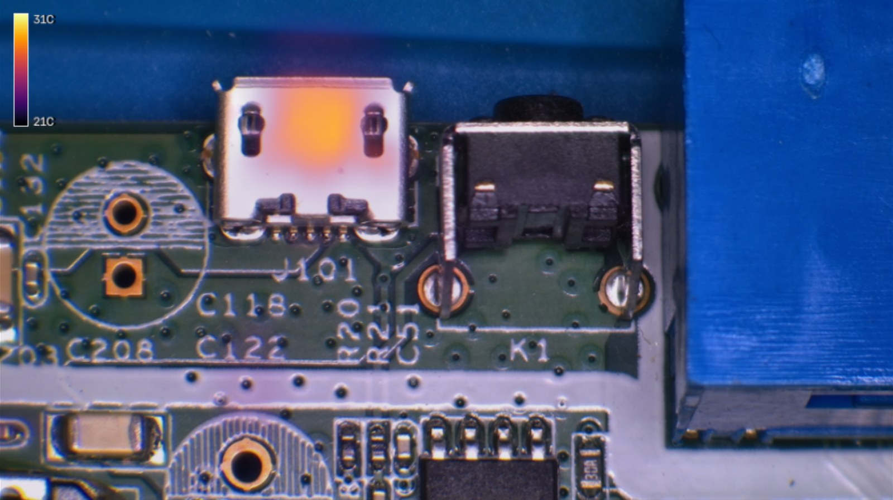
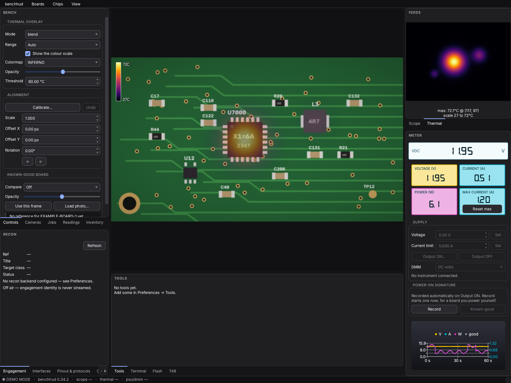

# benchhud

A heads-up display for a microsoldering repair bench. It fuses a live microscope
feed with a thermal overlay — so the component that's cooking lights up on the
scope image, labeled with its temperature — reads your bench instruments over
serial, and pushes the whole composite out as a virtual camera for OBS.

It started as "I want to see which part is overheating without looking away from
the scope" and turned into the bench's command center.



*The fused output: the USB connector is the warm part, so it's the part that
glows — on the scope image, with the rest of the board left alone.*

> **Status: running on the reference bench.** Scope capture, the thermal
> overlay with real temperatures, and virtual-camera output into OBS all run
> there on Ubuntu, and macOS virtual-camera output is verified on real hardware
> too. Still off-hardware: the OWON's write commands, and the Windows build —
> its terminal panel and its virtual camera both pass on CI's Windows runner,
> where a DirectShow reader gets the HUD's picture back byte for byte, but no
> Windows bench has run either and nobody has watched it in OBS there. Releases
> land often, so expect the odd rough edge.

## What it does

- **Scope + thermal fusion** — a thermal camera registered onto the microscope
  image, so the heat bloom sits over the actual component. Line it up with two
  touches of a hot iron tip. Warm-parts blend, isotherm outlines, threshold
  tint, or a marker with a live temperature label. This is the headline.
- **Known-good compare** — save a good board's scope frame per board number,
  then fade it over the live view or blink between them to spot what's missing.
- **Instrument telemetry** — live DMM / PSU readings over SCPI in a bench-style
  meter with peak-hold and a V/A/W trend graph, on-screen and optionally burned
  into the stream.
- **Repair jobs** — a local-first log of what's on the bench. One button attaches
  the current scope frame, thermal frame, and meter readings to the job timeline,
  and an over-current trip logs itself. Export a customer-facing report when it's
  done. `benchhud job new | select` picks the job from a terminal, so the job
  card on stream doesn't need a walk to the bench. [More →](docs/JOBS.md)
- **Ticket import** — optionally pull the open queue from a shop intake system
  and drop a ticket onto the bench as a job. Runs standalone without one.
  [More →](docs/INTAKE.md)
- **Board docs** — a local library of board-view files keyed by part number.
  "Do I have this board?" answered from the job, from a quick search, or across
  the whole open ticket queue as a boards-to-source list. Opens in OpenBoardView
  or FlexBV; file a schematic PDF beside the board and FlexBV cross-probes it.
  [More →](docs/BOARDS.md)
- **Tool launcher** — opens the repair tools you already use (OpenBoardView,
  minipro-gui, whatever's in your config) straight from the HUD.
- **Virtual camera out** — the composite is written to a v4l2loopback device, so
  OBS treats it as a normal camera source.
- **OBS browser sources** — the meter, the power graph, the job card and a
  now-playing banner (the track playing on the bench, artwork and all), each
  served as its own transparent page on localhost, so every panel is a separate
  OBS source you can place anywhere. Never shows the customer.
  [More →](docs/BROWSER-SOURCES.md)
- **Terminal** — your shell in a panel, and optionally on stream as a read-only
  OBS source with a pause button for anything private. macOS and Linux.
  [More →](docs/TERMINAL.md)
- **Flash** — read, back up and write SPI flash chips with flashrom, and chips on
  a T48 programmer with minipro. A backup is two reads that must match, and
  every dump is filed with the job.
  [More →](docs/FLASH.md)
- **Readings** — test-point measurements from the DMM, compared live with a
  known-good board of the same part number. A short shows up as LOW the moment
  you probe it. [More →](docs/READINGS.md)
- **Power-on signatures** — the current draw for the first seconds after Output
  ON, saved on the job and compared with a known-good board: a rail that never
  comes up shows as LOW. [More →](docs/POWER-ON.md)

Everything lives in dockable panels — arrange the bench the way you work, and the
layout sticks across restarts.



*The HUD on the bench. Controls on the left, the fused view in the middle, the
raw thermal feed and the meter on the right, the rest of the panels tabbed along
the bottom.*

## How it works

One process owns the cameras and builds the composite; OBS gets the output, never
the raw devices. That's deliberate — **a UVC camera allows one reader at a time**,
so benchhud is the sole reader of both the scope and thermal cams, and OBS pulls
the composited virtual cam. If OBS "can't open" a camera, that's why.

The pipeline is the obvious one — capture → register → analyze → composite →
output — with each camera on its own thread feeding a latest-frame buffer, so a
slow feed never stalls the loop. The thermal side reads the raw **Y16** stream
(not the pre-colormapped MJPEG) and converts to real per-pixel °C. That's what
makes "that pad is 78°C" possible instead of just a pretty picture.

## Platforms

Linux-first, because that's the OS the reference bench runs — not because the
others are optional. **macOS and Windows are committed targets**, not ports
someone might get to. The app itself is portable and runs on all three today;
what's platform-specific is virtual-camera output, which talks to a different OS
interface on each: v4l2loopback on Linux ([BENCH-SETUP.md](docs/BENCH-SETUP.md)),
OBS's camera extension on macOS ([MACOS-SETUP.md](docs/MACOS-SETUP.md)), and
softcam, a DirectShow camera that ships in the installer, on Windows
([WINDOWS-SETUP.md](docs/WINDOWS-SETUP.md)). Where a backend can't open, the
status bar says why rather than streaming nothing quietly.

## Install

Every [release](https://github.com/IamMrCupp/benchhud/releases) carries its
installers, built and install-checked by CI at the release tag.

**Ubuntu (the bench).** The `.deb` from the latest release, for Ubuntu 26.04
on amd64:

```sh
gh release download --repo IamMrCupp/benchhud --pattern '*.deb'
sudo apt install ./benchhud_*.deb
```

Or from the bench apt repo, which also brings updates with `apt upgrade`:

```sh
sudo curl -fsSLo /usr/share/keyrings/bench-archive-keyring.gpg https://apt.yolorepair.com/bench-archive-keyring.gpg
echo "deb [signed-by=/usr/share/keyrings/bench-archive-keyring.gpg] https://apt.yolorepair.com stable main" \
  | sudo tee /etc/apt/sources.list.d/bench.list
sudo apt update
sudo apt install benchhud        # or bench-suite, for the whole bench (below)
```

`apt install` (not `dpkg -i`) pulls in the libraries Qt needs. It shows up in
the app menu as **benchhud**. Two one-time steps are left to you, since a
package shouldn't do them behind your back: join the `video`, `dialout` and
`plugdev` groups, and load v4l2loopback for virtual-camera output. Both are in
[BENCH-SETUP.md](docs/BENCH-SETUP.md).

**The whole bench in one go (optional).** `sudo apt install bench-suite` from
that repo installs benchhud with the three services below, and
`sudo bench-setup` then walks through the rest: one password for the services,
their tokens written into benchhud's config, the virtual-camera node, the
camera names, and what to tell OBS. It asks before it changes anything, and
`bench-setup doctor` checks the result. Nothing here needs it; it saves the
copying. See [bench-suite](https://github.com/IamMrCupp/bench-suite#readme).

**Windows.** The `.msi` from the latest release. It's ad-hoc signed, so
SmartScreen warns on first run. Install it for everyone on the PC and the
virtual camera is registered as part of the install; install it just for
yourself, with no admin rights, and benchhud registers the camera from
Preferences → Output with one approval prompt
([WINDOWS-SETUP.md](docs/WINDOWS-SETUP.md)). The terminal panel runs `cmd.exe`
or PowerShell ([TERMINAL.md](docs/TERMINAL.md#windows)). Both are checked on
CI's Windows runner, not yet on a Windows bench.

**macOS.** The `.dmg` from the latest release, for Apple silicon: signed with a
Developer ID and notarized, so it opens without a Gatekeeper warning. Drag
benchhud to Applications. Or with [Homebrew](https://github.com/IamMrCupp/homebrew-bench),
which also brings updates with `brew upgrade`:

```sh
brew tap iammrcupp/bench
brew install --cask benchhud
```

For OBS, see [MACOS-SETUP.md](docs/MACOS-SETUP.md);
to build and sign your own, [PACKAGING.md](docs/PACKAGING.md).

**The whole bench on a Mac (optional).** The same tap has a `bench-suite` cask:
benchhud, the benchhud-intake and bench-parts menu-bar apps, and `bench-setup`.

```sh
brew tap iammrcupp/bench
brew trust --tap iammrcupp/bench
brew install --cask bench-suite
bench-setup
```

`bench-setup` sets one password for the two menu-bar apps, makes a token each,
and writes the URLs and tokens into benchhud's config. `bench-setup doctor`
checks the result, including that macOS has OBS's camera extension turned on.
macOS asks before the first launch of a download, so `bench-setup` will tell
you to open each menu-bar app once from Applications, then run it again.
Nothing here needs it. See [bench-suite](https://github.com/IamMrCupp/bench-suite#on-a-mac).

**From source (any OS).** `uv run benchhud`; see *Development* below.

The shop side runs separately, with its own installers (Linux service `.deb`,
Windows and macOS tray apps, Docker, Kubernetes):
[benchhud-intake](https://github.com/IamMrCupp/benchhud-intake) for tickets and
[bench-parts](https://github.com/IamMrCupp/bench-parts) for parts inventory.
[bench-recon](https://github.com/IamMrCupp/bench-recon) sits beside them as the
system of record for hardware pentest engagements. Each one shows up as a panel
in the HUD once you point benchhud at it — by hand in Preferences (**Find on
this machine** fills in the address of one running on the same computer), or with
[bench-suite](https://github.com/IamMrCupp/bench-suite), above.

## Hardware

benchhud isn't locked to specific gear — device paths are config — but it's
developed against:

- **Scope:** a UVC microscope camera (BTER 4K) — over USB, or its HDMI output
  through a capture card (an Elgato Cam Link 4K on the reference bench).
- **Thermal:** Sipeed T256s — 256×192 LWIR, raw Y16 for true temperatures.
- **Instrument:** OWON SPM8104 (PSU + DMM) over SCPI serial.

Set your device paths in `config.example.toml`, or pick them from dropdowns in
**Preferences** once the app is running.

## Development

Needs [uv](https://docs.astral.sh/uv/).

```sh
uv sync            # env + deps from the lockfile
uv run benchhud    # launch
uv run pytest      # tests
uv run ruff check  # lint
```

The whole thing runs without hardware — the default source is a synthetic test
pattern, so `uv run benchhud` opens a working shell you can poke at.

| Doc | What's in it |
|---|---|
| [ARCHITECTURE.md](docs/ARCHITECTURE.md) | Module map, the hardware seams, design rules. |
| [BENCH-SETUP.md](docs/BENCH-SETUP.md) | Bringing it up on the Linux bench — cameras, the OWON, v4l2loopback → OBS. |
| [MACOS-SETUP.md](docs/MACOS-SETUP.md) | Publishing into OBS's virtual camera on a Mac. |
| [WINDOWS-SETUP.md](docs/WINDOWS-SETUP.md) | The Windows virtual camera: registering it, and adding it to OBS. |
| [PACKAGING.md](docs/PACKAGING.md) | The packages: the Ubuntu `.deb`, the Windows MSI, the signed macOS `.app`, releases, and what CI builds when. |
| [BROWSER-SOURCES.md](docs/BROWSER-SOURCES.md) | The data panels as OBS Browser sources: URLs, what goes on air. |
| [TERMINAL.md](docs/TERMINAL.md) | The terminal panel and its read-only stream view. |
| [POWER-ON.md](docs/POWER-ON.md) | Power-on current signatures compared with a known-good board. |
| [READINGS.md](docs/READINGS.md) | Test-point readings compared with a known-good board. |
| [FLASH.md](docs/FLASH.md) | The Flash panel: backing up and writing SPI chips with flashrom. |
| [JOBS.md](docs/JOBS.md) | The repair log: jobs, captures, fault logging, reports. |
| [INTAKE.md](docs/INTAKE.md) | Pulling tickets from a shop intake system. |
| [BOARDS.md](docs/BOARDS.md) | The board-view library: find, open, and source boards. |

## License

Open source under the [GNU Affero General Public License v3.0](https://www.gnu.org/licenses/agpl-3.0.html)
or later — see [LICENSE](LICENSE). Use it, change it, ship it. If you distribute
a modified build, or run one as a service other people use, your changes go out
under the same licence.

Copyright © 2026 Aaron Cupp. If the AGPL doesn't fit how you want to use it, a
commercial licence is available — get in touch.

Releases up to and including 0.14.5 were published under the PolyForm Small
Business License 1.0.0. Those releases are also available under the
AGPL-3.0-or-later.

The Y16→°C conversion follows Sipeed's documented spec for the T256s; credit to
them for the formula.

The meter's segmented-LCD digits use the [DSEG](https://github.com/keshikan/DSEG)
font by keshikan, bundled under the SIL Open Font License 1.1 — see
[resources/fonts/OFL.txt](src/benchhud/resources/fonts/OFL.txt).
